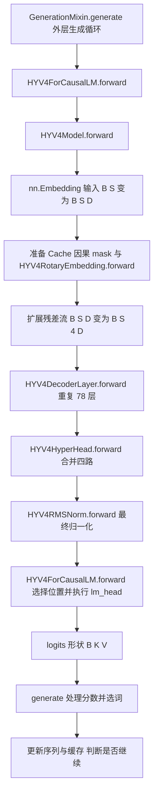
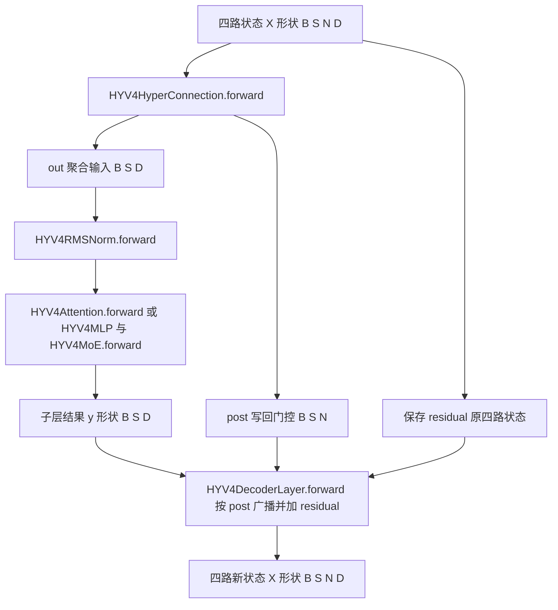
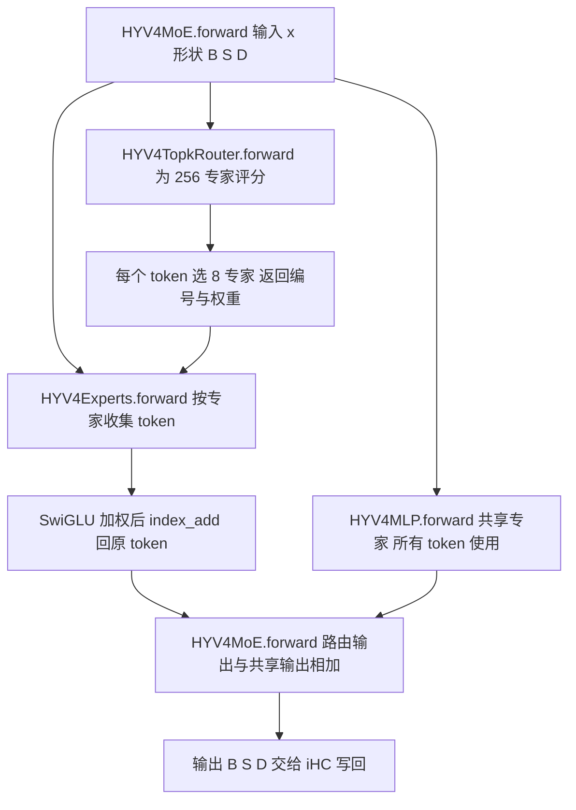

# Hy4 模型结构学习笔记

从 Transformers 前向计算理解聚合 分支与专家路由

整理日期：2026 年 10 月 19 日。对象：Hy4-preview 语言模型。本文围绕学习中最容易混淆的聚合、分支、门控和 MoE，沿代码调用关系解释结构，再说明它们为什么这样设计。

核心认识：Hy4 在层间维护四路完整残差状态；每个 Attention 或 FFN 子层先从四路状态读出一个向量，完成计算后再按门控写回。MoE 位于 FFN 内部，为每个 token 选择部分专家；它与四路残差结构是两个独立维度。

## 1 阅读依据与范围

本文的代码依据固定为 Transformers 提交 `c8b25ab3af135bcfd9496eff3ef507303da17f15` 中的 `modeling_hy_v4.py`，避免 main 分支更新后无法对照。模型尺寸来自腾讯权重仓库的 config.json，于整理日期读取；配置页面仍可能更新。

- [固定版本前向代码](https://github.com/huggingface/transformers/blob/c8b25ab3af135bcfd9496eff3ef507303da17f15/src/transformers/models/hy_v4/modeling_hy_v4.py)
- [官方模型配置](https://huggingface.co/tencent/Hy4-preview/blob/main/config.json)
- [官方中文模型说明](https://github.com/Tencent-Hunyuan/Hy4-preview/blob/main/README_CN.md)

正文以可执行代码为准。模块设计带来的表达自由度属于结构分析，不能仅由代码推断其实际收益，也不能认定四路或各专家已经学出固定语义分工。本文不把推理前向代码当作完整预训练方案。

### 1.1 形状符号

| 符号 | 含义 | 本模型取值或约定 |
| --- | --- | --- |
| B | batch 中的序列数 | 随输入变化 |
| S | 本次输入的 token 数 | 完整输入时可较大，逐 token 解码通常为 1 |
| P | 已缓存的历史长度 | 首次输入通常为 0 |
| T | 当前可访问的 KV 总长度 | 简化情况下为 P + S |
| D | 隐藏维度 | 6144 |
| N | 残差流数量 | 4 |
| H | 主注意力头数 | 64 |
| E | 每个 MoE 层的路由专家数 | 256 |
| Kₑ | 每个 token 激活的路由专家数 | 8 |
| Kₐ | DSA 索引数量上限 | 2048 |
| V | 词表大小 | 120832 |

配置中有 78 层，第一层为 Dense FFN，后面 77 层为 MoE。Dense 中间维度为 18432，单个路由专家中间维度为 2048，共享专家数为 1。模型配置类的默认值可能与发布权重不同，尺寸以实际 config.json 为准。

## 2 整体结构与生成流程

图 1 中，实线向下表示一次 forward。选词和停止判断在外层生成循环；训练时可直接对 logits 计算 loss。

ps:关键参数配置在https://huggingface.co/tencent/Hy4-previewhttps://huggingface.co/tencent/Hy4-preview 中的config.json



### 2.1 HYV4Model.forward 的执行顺序

1. 检查 input_ids 与 inputs_embeds 恰好提供一个。前者是整数 ID，后者是现成向量。
2. 需要时执行 Embedding，将 `[B,S]` 映射到 `[B,S,D]`。
3. 启用缓存且没有传入对象时，建立 DynamicCache；后续各层写入自己的缓存。
4. 没有显式位置编号时，以历史长度 P 为起点生成本次 S 个位置。RoPE 模块准备 cos 和 sin，真正旋转发生在 Attention 内，不能理解为把位置向量加到 Embedding。
5. 准备因果与 padding 约束。因果约束决定允许关注哪些位置，DSA 再限制关注集合；选出索引不代表解除因果约束。
6. 将输入扩展为 `[B,S,4,D]`。四路初始内容相同，后续通过不同的写回门控可以产生差异。
7. 顺序调用各层，传递四路状态及稀疏 token 索引；缓存对象也传入各层。
8. HyperHead 将四路聚合为 `[B,S,D]`，再执行最终 RMSNorm。
9. 返回 MoeModelOutputWithPast。这里的 last_hidden_state 还不是词表分数。

### 2.2 从隐藏状态到 token

外层 HYV4ForCausalLM.forward 获取 last_hidden_state，按 logits_to_keep 选取序列位置，再对齐到 lm_head 权重 dtype 并投影到词表。若保留 K 个位置，形状为 `[B,K,D] → [B,K,V]`。

logits_to_keep 为整数 1 时只取末尾位置；为 0 时取全部位置，因为 Python 中 -0 等于 0。只取部分位置节省的是输出投影开销，不会撤销前面主干已经执行的计算。

logits 是分数，不是 token ID。generate 会在外部处理分数并执行贪心选择或随机采样，随后继续 forward；model.forward 本身不需要选择 token。提供 labels 时才调用 loss_function。具体标签移位和忽略规则位于损失函数中，不能从这几行自行假定其全部行为。

## 3 一层 Decoder 内部发生什么

图 2 把一次子层更新展开。Attention 和 FFN 各执行一遍同样的读写结构，使用各自独立的 HyperConnection 参数。



单层顺序为：attn_hc 读出 → input_layernorm → self_attn → 按 post 写回 → ffn_hc 读出 → post_attention_layernorm → mlp → 按 post 写回。

同一个 hidden_states 变量在 `[B,S,N,D]` 与 `[B,S,D]` 之间反复变化。阅读源码时，应根据当前赋值重新判断形状，不能认为它始终代表同一种状态。

四路旧状态在 residual 中直接保留。这里没有四次 Attention，也没有四个独立模型；四路经过聚合后，只执行一次相应的子层，再将结果写回各路。

## 4 iHC 的读取与写回原理（全称是 identity Hyper-Connections。其中 identity指旧的多路残差状态直接保留，再加入门控控制的新结果）

### 4.1 pre post out 分别是什么

对一个 token，设 N 路状态为 X₁ 到 Xₙ，每路均是 D 维向量。忽略数值精度细节，一次子层计算为：

```text
u = Σᵢ preᵢ × Xᵢ
y = F(RMSNorm(u))
Xᵢ_new = Xᵢ + postᵢ × y
```

| 名称 | 含义 | 形状 | 使用时机 |
| --- | --- | --- | --- |
| pre | 从每一路读取多少 | B S N | 聚合子层输入 |
| out 或 u | 聚合后的特征向量 | B S D | 送入归一化和子层 |
| post | 将子层结果写回每路多少 | B S N | 子层执行后 |
| residual | 保留的旧多路状态 | B S N D | 与门控更新相加 |

这些是信息处理角色，不对应严格的物理量。每个 token 的每一路只有一个 pre 标量和一个 post 标量；它们会广播到该路全部 D 个特征。post 在子层执行前由输入算出，虽然它在子层之后使用。

### 4.2 HYV4HyperConnection.forward 的逐步计算

第一步，读取设备并禁用这段 autocast。再把输入转成 FP32，降低门控和残差计算中的数值误差。禁用 autocast 本身不等于自动转换所有张量，实际精度还依赖显式类型转换。

第二步，flatten(2) 把流维和特征维拼成 `[B,S,N×D]`。这是拼接，不是求和，也不聚合 token。

第三步，通过 fn 权重投影到 2N 维，再乘逆 RMS 因子。注意 HYV4UnweightedRMSNorm.forward 仅返回逆 RMS 缩放，不返回输入乘缩放后的向量。

```text
r = 1 / sqrt(mean(flat²) + eps_norm)
mixes = Linear_without_bias(flat) × r
形状：B S ND → B S 2N
```

第四步，把 base、scale、mixes 分成读取和写回两支。base 是各路的可学习基础偏置；scale 是两支分别使用的可学习标量；mixes 提供随 token 输入变化的动态信号。

```text
pre  = sigmoid(pre_logits × pre_scale + pre_base) + eps_hc
post = magnitude × sigmoid(post_logits × post_scale + post_base) + eps_hc
```

pre 不使用 softmax，所以各路权重和不必为 1。magnitude 为 2 时，post 的数学范围为 `(eps_hc, 2 + eps_hc)`；浮点计算可能接近端点。post 控制新更新的幅度，旧状态仍以系数 1 保留。

第五步，给 pre 插入末尾维度，将 `[B,S,N,1]` 与输入 `[B,S,N,D]` 相乘，沿流维求和得到 out。只合并同一个 token 的各路，不跨 token 求和。

第六步，返回 post 和恢复为输入 dtype 的 out。pre 已经用于读出，所以不必返回。Decoder 后续在 FP32 中完成广播乘法和残差相加，再恢复原 dtype。

### 4.3 为什么需要多路

普通残差每个 token 只有一个累积状态，更新都进入同一向量。X_new = X + F(RMSNorm(X))

多路残差增加了状态保存和读写选择的自由度：不同子层可以读取不同组合，并把结果以不同幅度写到各路。增加表达能力。

初始四路相同并不意味着它们永远相同，因为两路差值会按以下方式改变：

```text
Xᵢ_new − Xⱼ_new = Xᵢ − Xⱼ + (postᵢ − postⱼ) × y
```

只要 post 不同，即使旧状态相同，也可能产生不同的新状态。但这不保证各路学出互补分工；实际利用程度需要训练和诊断实验验证。

四路不是把 6144 维切成四份，而是维护四个完整的 6144 维状态。它们也不是 64 个 Attention head，更不是 256 个专家。

### 4.4 为什么子层前要聚合

Attention 与 FFN 仍接收 D 维输入。先聚合，就不必将主要网络整体拓宽到 ND，也不必为 N 路分别执行完整子层。多路激活、门控和读写本身仍有开销，因此不是无成本扩展。

聚合形成了 D 维的计算入口，会压缩子层本次看到的信息；但原多路状态在 residual 中保存。中间聚合是一种读取，不会把所有旧状态永久替换成 out。

iHC 的恒等残差路径直接传递旧状态，没有在此实现中显式对旧状态乘一个可学习的 N×N 混合矩阵。跨路交流通过读出、子层变换与写回实现。恒等路径有利于保留直接传播通道，但不能据此断言整个网络的梯度一定稳定。

### 4.5 用一组数字理解

仅为演示令 D=1，四路为 `[1,2,3,4]`，pre 为 `[0.4,0.3,0.2,0.1]`，得到 out=2。假设子层返回 y=10，post 为 `[0.2,0.5,1.0,1.5]`，写回得到 `[3,7,13,19]`。

这个例子中的 pre 恰好和为 1，只是为了方便计算；真实代码没有要求。四路的区别来自不同更新历史，不能人为指定为语法路、知识路等。

## 5 HyperHead 为什么还要再聚合

HYV4HyperHead.forward 出现在全部 Decoder 结束后。此时模型不再需要维护多路状态，需要一个 D 维向量交给最终 RMSNorm 与词表投影。

其步骤为：取得设备 → 关闭 autocast → 拼平输入并转 FP32 → 投影到 N 维并乘逆 RMS → sigmoid 生成最终读取门控 → 沿流维加权求和 → 恢复输入 dtype。

```text
输入 x          [B,S,N,D]
flat            [B,S,N×D]
mixes 与 pre    [B,S,N]
out             [B,S,D]
```

它只有读取，没有 post，因为后面不再写回各路。最终合并后，多路差异不再继续独立传播。HyperHead 合并残差流；LM Head 将隐藏向量投影到词表，两者职责不同。

## 6 Dense FFN 与 SwiGLU 的分支

HYV4MLP.forward 对每个 token 独立执行以下特征变换，所有位置共用这层参数：

```text
gate = SiLU(W_gate × x)
up   = W_up × x
h    = gate ⊙ up
y    = W_down × h
```

gate_proj 与 up_proj 都把 D 维变为 M 维，再逐元素相乘；down_proj 把 M 维变回 D 维。这两条特征分支不维护跨层状态，和 iHC 四路不同。

SiLU 的门控值不是概率，可以为负或大于 1。这里 gate_proj 不选择专家，只调制中间特征。该模块本身没有外层残差相加，真正的残差更新由 Decoder 处理。

## 7 MoE 的专家分支与聚合

图 3 表示一个 token 的逻辑路径。批处理实现会先将 B 和 S 合并，按专家收集 token，再把结果累加回原位置。



### 7.1 HYV4MoE.forward 的逐步路径

1. 保存输入和原形状。变量 residuals 在这里是共享专家的输入备份，不表示直接将原输入加到 MoE 输出。
2. Router 返回专家分数、top-k 权重和专家编号；MoE 主体保留后两项。
3. 将输入由 `[B,S,D]` 整理为 `[B×S,D]`，便于 token 分发。这不是将不同 token 相加。
4. 执行选中的路由专家，按权重累加，恢复 `[B,S,D]`。
5. 对原始输入执行共享专家，加入路由结果，返回。

```text
MoE(xₜ) = SharedMLP(xₜ) + Σₑ∈Selected(t) weightₜₑ × Expertₑ(xₜ)
```

共享专家与路由专家都读取原 FFN 输入。它们是并列的两支，而不是先过专家再过共享网络。

### 7.2 Router 如何选专家

HYV4TopkRouter.forward 将输入展平，使用 FP32 线性投影计算 E 个原始专家分数，再应用 sigmoid。

```text
scoreₑ = sigmoid(router_logitₑ)
choice_scoreₑ = scoreₑ + correction_biasₑ
```

选择专家使用 choice_score；混合权重则从未加偏置的 score 中取。这使“是否被选中”和“输出贡献大小”成为相关但不完全相同的决策。

代码支持专家分组筛选；本配置 n_group=1 且 topk_group=1，只有一个组，因此没有进一步排除其他组的效果。随后选出 8 个路由专家。

本配置开启 norm_topk_prob，选中权重先除以选中分数之和，再乘 routed_scaling_factor=2.827。因此最终权重之和约为 2.827，而不是 1。共享专家直接相加，没有再乘这个 top-k 路由权重。

每个 token 独立做 top-k。专家不是预先按词或任务硬编码分类，不能从“专家”一词推断为八种固定能力。

### 7.3 Experts 如何执行分发与回收

HYV4Experts 的 gate_up_proj 参数形状为 `[E,2M,D]`，down_proj 为 `[E,D,M]`。第一个维度表示不同专家拥有各自参数；gate 和 up 打包存储，计算后拆开。

forward 先准备零输出，再根据 top-k 编号建立 token 与专家的对应关系，找出本批实际使用的专家。对每个使用的专家：收集 token → SwiGLU 变换 → down 投影 → 乘各 token 的路由权重 → index_add_ 累加回原 token。

一个 token 经过 8 个路由专家，必须累加其结果，不能用最后一个专家覆盖前面的输出。代码中的 no_grad 包住离散分发索引构造，不代表专家线性层和整个 MoE 都不计算梯度。

路由专家的 _apply_gate 会对 gate 分支设上界、对 up 分支做双侧截断，再执行 SiLU 与逐元素相乘。HYV4MLP 的直接实现没有这段截断，因此两者是相近的网络形式，不应声称所有数值细节完全相同。

### 7.4 为什么使用 MoE

MoE 保存大量专家参数，每个 token 只执行部分专家，增加参数容量而避免逐 token 计算全部专家。49B 激活参数不代表只需存储 49B 参数；部署仍需考虑所有专家权重、缓存及并行通信。

Dense 与 MoE 的输入输出接口相同，因此 Decoder 可以按配置替换 FFN，而外层 iHC 的读写结构不变。

## 8 MLA Gated DSA 与 IndexCache

这三项解决不同问题：MLA 压缩注意力缓存表示；DSA 选择可关注的历史 token；IndexCache 减少相邻层重复计算稀疏索引。它们与 MoE 选择专家相互独立。

### 8.1 HYV4Attention.forward 的计算路径

1. gate_proj 从输入生成注意力输出门控，形状按 head 和 value 特征展开。
2. q_a_proj 将 D 维压到 q_lora_rank=2048，经 RMSNorm 后由 q_b_proj 展开为多头查询。
3. kv_a_proj_with_mqa 产生压缩内容与位置分量；内容维度为 kv_lora_rank=512，位置分量为 64。
4. 对查询和键的位置部分应用 RoPE。
5. 缓存读写发生在 KV 内容仍压缩时，保留压缩内容和位置分量。
6. expand_kv 通过 kv_b_proj 展开内容键和值，并拼接位置键。该 Transformers 路径为可读性展开了中间表示，不等于所有推理后端都采用同一内存布局。
7. 运行本层 indexer 或复用已有索引；按照后端用 mask 或稀疏索引约束注意力。
8. 执行注意力，将结果逐元素乘 sigmoid 输出门控，再经 o_proj 回到 D 维。

主注意力的每头查询由 192 维非位置部分和 64 维位置部分组成，每头 value 为 256 维。不能机械套用普通多头注意力中 head_dim=D/H 的假设。

### 8.2 HYV4Indexer.forward 选择什么

Indexer 有自己的轻量 Q/K 投影。它计算各查询与历史位置的相关性，经过 ReLU、多索引头加权与因果约束后，返回 `[B,S,Kₐ]` 的位置编号。实际数量不超过当前 KV 长度；较短前缀的不可见位置仍由因果 mask 屏蔽。

这与主注意力的 softmax 权重不同：Indexer 先决定候选位置，主注意力随后在约束下计算内容聚合。源码中的返回语句比部分旧注释更可靠，该实现返回的是索引。

稀疏选择不自动意味着所有后端都获得相同加速。当前 eager 路径仍可能计算稠密分数再施加 mask；真正利用稀疏结构的 kernel 才能避免相应无效计算。索引器本身也有评分开销。

### 8.3 IndexCache 复用什么

indexer_types 中 full 层计算新索引，shared 层复用最近传下来的 full 索引。各层仍用自己的参数和隐藏状态计算主注意力，并使用各自的缓存。

复用的不是 logits、Attention 输出、专家集合或整层隐藏状态。这样做基于相邻层选择位置可能存在冗余的思路；准确性与收益需要实测。

主注意力还包含每头可学习的 sink logit：源码将它加入归一化分母，随后丢掉该项对内容聚合的贡献。可将其理解为允许一部分归一化质量不分配给真实 value，而不是一个额外存储语义的普通 token。

## 9 三种聚合与五类门控

| 机制 | 选择或调制对象 | 聚合沿哪个维度 | 是否依赖其他 token |
| --- | --- | --- | --- |
| iHC pre | 同一 token 的残差流 | N 路求和 | 门控直接读取当前位置状态 |
| iHC post | 同一子层结果的写回幅度 | 写回各路，无求和合并 | 直接读取当前位置状态 |
| SwiGLU gate | M 维中间特征 | 逐元素乘法后线性投影 | 否 |
| MoE Router | E 个专家 | 选中专家输出加权求和 | 每个 token 独立路由 |
| Attention 输出 gate | 每头 value 特征 | 逐元素乘法 | 门控由本位置输入生成 |
| Attention 权重 | 历史 token 的 value | 历史位置维求和 | 是 |

因此，看到 sum、gate 或 top-k 时，先问它作用在哪个轴。MoE top-k 选专家；DSA top-k 选 token。iHC 聚合残差流；Attention 聚合上下文；MoE 聚合专家输出。这些机制可以同时存在而不冲突。

## 10 一次输入的形状演练

假设 B=2、S=5，完整输入且暂不考虑 padding：

| 阶段 | 张量形状 |
| --- | --- |
| token ID | 2 × 5 |
| Embedding | 2 × 5 × 6144 |
| 层间四路状态 | 2 × 5 × 4 × 6144 |
| iHC pre 与 post | 各为 2 × 5 × 4 |
| 子层聚合输入 | 2 × 5 × 6144 |
| Router 输入 | 10 × 6144 |
| Router 全专家分数 | 10 × 256 |
| 选中专家编号与权重 | 各为 10 × 8 |
| MoE 输出 | 2 × 5 × 6144 |
| iHC 写回后 | 2 × 5 × 4 × 6144 |
| HyperHead 后 | 2 × 5 × 6144 |
| 仅末尾位置的词表分数 | 2 × 1 × 120832 |

下一步逐 token 生成时，本次 S 通常为 1，P 增大。过去 token 的各层缓存被复用，不需要每次把全部提示词重新做完整前向。当前输入的 S 与可见历史长度 T 必须分开理解。

## 11 阅读路线与自测

建议先读 HYV4Model.forward 与 HYV4DecoderLayer.forward，再读 HyperConnection、HyperHead、MLP、MoE、Router、Experts，最后进入 Attention 与 Indexer。先确定每个算子的输入输出轴，再研究数值优化。

可以用以下问题检查理解：

1. 四路聚合为一路后，旧四路为何仍在？因为 residual 保留旧状态，out 仅作为子层本次输入。
2. pre 与 post 是否是概率分布？不是；它们不经过跨路 softmax，不要求和为 1。
3. MoE 内 residuals 是否直接加到输出？不是；它是共享专家读取的原输入。
4. 共享专家是否接收路由后的结果？不是；两支都接收原 FFN 输入。
5. 全部 token 是否共享同一个 top-k？不是；每个 token 自己选专家或历史位置。
6. 同一个模型为何能同时有四路、64 头和256 专家？三者分别属于残差状态、注意力表示和 FFN 参数选择。
7. forward 返回 logits 后为何没有采样？采样属于 generate 的外部循环。
8. shared 索引层是否跳过整层 Attention？不会，只复用索引，主计算仍独立执行。

在纸上为一个子层写出 `X → pre 聚合 → F → post 写回 → X_new`，并为一个 token 写出 `共享专家 + 八个路由专家加权和`，比直接记住所有类名更能检验结构理解。

## 12 代码入口与延伸资料

下列代码入口在 HTML 阅读版中会定位到固定提交的对应定义：

- [HYV4Model.forward](https://github.com/huggingface/transformers/blob/c8b25ab3af135bcfd9496eff3ef507303da17f15/src/transformers/models/hy_v4/modeling_hy_v4.py#L801)：主干输入准备、层循环和最终合并。
- [HYV4DecoderLayer.forward](https://github.com/huggingface/transformers/blob/c8b25ab3af135bcfd9496eff3ef507303da17f15/src/transformers/models/hy_v4/modeling_hy_v4.py#L680)：Attention 与 FFN 的两次 iHC 读写。
- [HYV4HyperConnection.forward](https://github.com/huggingface/transformers/blob/c8b25ab3af135bcfd9496eff3ef507303da17f15/src/transformers/models/hy_v4/modeling_hy_v4.py#L621)：动态读写门控与子层输入聚合。
- [HYV4HyperHead.forward](https://github.com/huggingface/transformers/blob/c8b25ab3af135bcfd9496eff3ef507303da17f15/src/transformers/models/hy_v4/modeling_hy_v4.py#L655)：最终多路合并。
- [HYV4MLP.forward](https://github.com/huggingface/transformers/blob/c8b25ab3af135bcfd9496eff3ef507303da17f15/src/transformers/models/hy_v4/modeling_hy_v4.py#L495)：Dense 与共享专家的 SwiGLU。
- [HYV4MoE.forward](https://github.com/huggingface/transformers/blob/c8b25ab3af135bcfd9496eff3ef507303da17f15/src/transformers/models/hy_v4/modeling_hy_v4.py#L593)：路由专家与共享专家的组织。
- [HYV4TopkRouter.forward](https://github.com/huggingface/transformers/blob/c8b25ab3af135bcfd9496eff3ef507303da17f15/src/transformers/models/hy_v4/modeling_hy_v4.py#L513)：专家选择及混合权重。
- HYV4Experts.forward 和 _apply_gate：分发、专家计算和累加。
- HYV4Attention.forward 和 expand_kv：压缩 KV、注意力与输出门控。
- [HYV4Indexer.forward](https://github.com/huggingface/transformers/blob/c8b25ab3af135bcfd9496eff3ef507303da17f15/src/transformers/models/hy_v4/modeling_hy_v4.py#L188)：稀疏位置选择。
- [HYV4ForCausalLM.forward](https://github.com/huggingface/transformers/blob/c8b25ab3af135bcfd9496eff3ef507303da17f15/src/transformers/models/hy_v4/modeling_hy_v4.py#L896)：词表投影、损失与输出包装。

相关原理资料按以下顺序阅读：

- [DeepSeek V3 Technical Report](https://arxiv.org/abs/2412.19437)：理解 MLA、MoE 与 MTP 的背景，不能将其全部训练细节直接套用到 Hy4。
- [DeepSeek V3.2](https://arxiv.org/abs/2512.02556)：理解 DSA 与索引器。
- [IndexCache](https://arxiv.org/abs/2603.12201)：理解跨层索引复用。
- [腾讯 README 引用的 iHC 文章](https://zhuanlan.zhihu.com/p/2010852389670908320)：与本模型的具体读写代码对照。

官方模型另带 MTP 能力，但本文所分析的这个 Transformers 主干文件没有展开完整 MTP 推测解码流程，不能把外部 generate 普通循环等同于 MTP 实现。模型说明与配置告诉我们发布了什么能力，具体后端代码告诉我们该能力如何执行。
